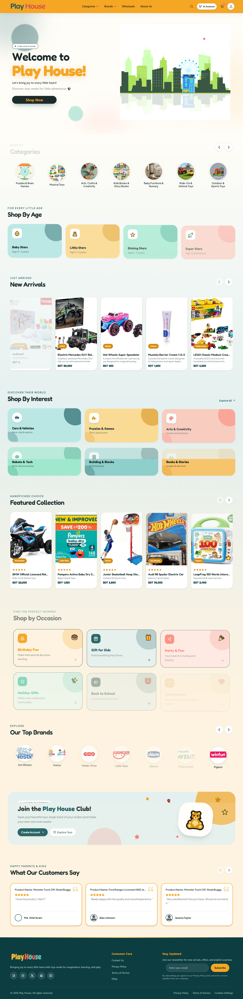
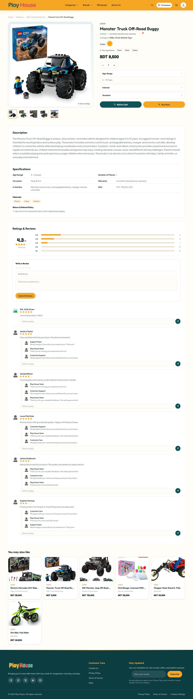
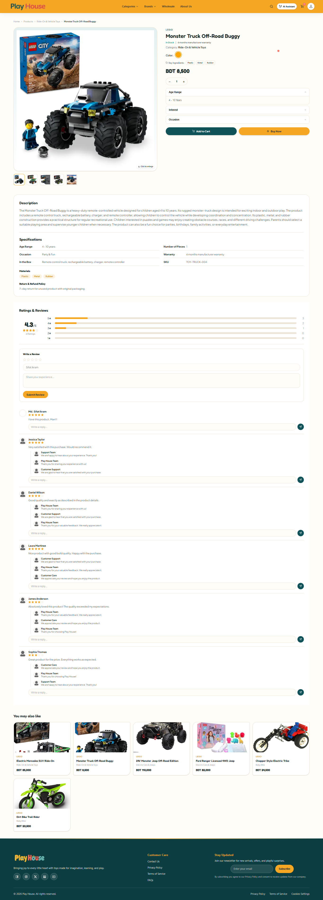
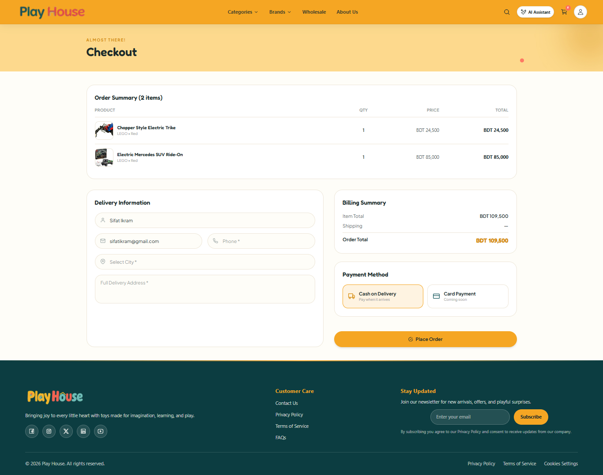
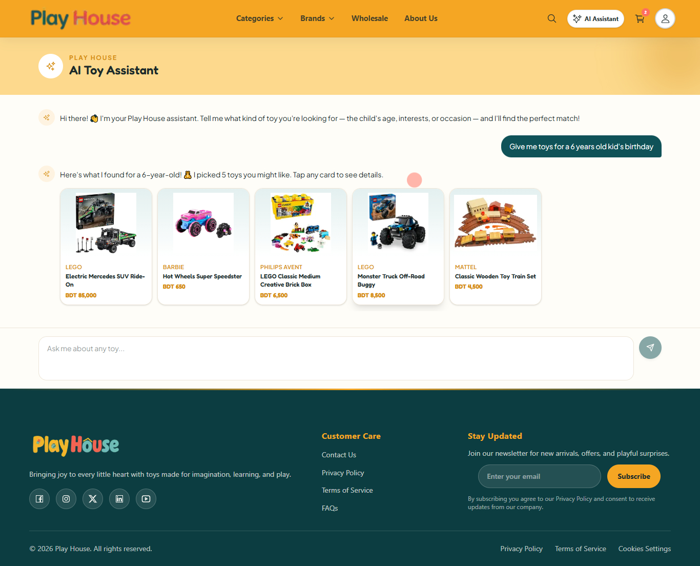
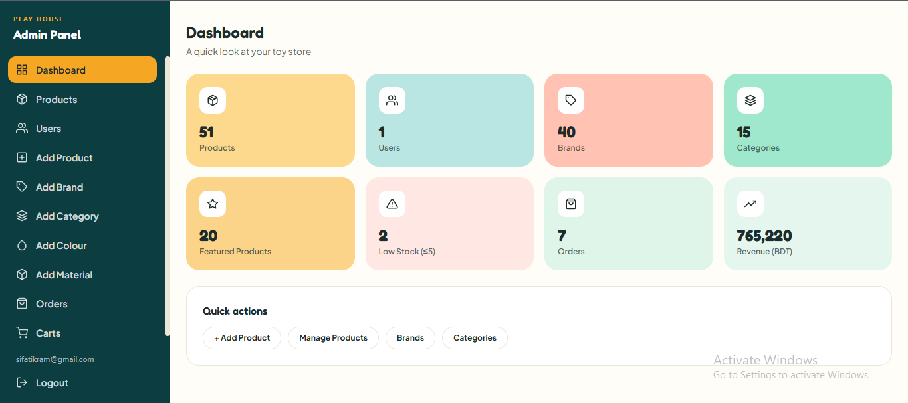

# 🧸 Play House: Full-Stack Toy Store E-Commerce Platform

> A playful yet classy online toy store with a customer storefront, an AI shopping assistant, order tracking, and a role-based admin dashboard.


**Live Demo:** [https://play-house-phi.vercel.app](https://play-house-phi.vercel.app)  
**Backend API:** https://play-house-backend.vercel.app/api

---

## 🔑 Demo Admin Access

Log in with the demo account below. Staff roles are redirected straight to the **Admin Dashboard** (`/admin`); regular users go to the storefront.

| | |
|---|---|
| **Email** | `sifatikram96@gmail.com` |
| **Password** | `sifatikram123456` |
| **Role** | `viewer`: explore every admin page, but all changes are disabled |

> The demo account is read-only by design, so you can freely explore orders, carts, products and analytics without affecting the data.

---

## ✨ Features

### Customer Storefront
- **Dynamic product browsing** by brand, category, interest, occasion, age range, wholesale and free-text search
- **Advanced filtering & sorting**: category, brand, interest, occasion, age, price range slider, price sort, with active filter chips
- **Smart pagination**: "Load More" that switches to numbered pagination for large result sets
- **Search autocomplete** with debounced suggestions
- **Product details** with colour variants, image gallery (thumbnails, hover zoom, lightbox), stock status, specifications and delivery info
- **Reviews & replies**: star rating summary, review submission (login required), open replies, "Load More Reviews"
- **Wholesale pricing module**: bulk deals surfaced through the product listing
- **Welcome modal** for first-time guests explaining the project, tech stack and GitHub links
- **Playful micro-interactions**: Framer Motion animations, confetti on add-to-cart, floating cart bar, custom cursor

### Cart, Checkout & Orders
- **Persistent cart for guests and logged-in users** (cookie/localStorage token + user-based cart, auto-merge on login)
- **Checkout for guests and authenticated users**, auto-filled from the user's **default saved address**
- **Saved addresses**: up to 5 per user, choose a default, one-tap selection at checkout
- **Transactional order placement**: real-time stock validation, server-side shipping cost calculation, price snapshot, automatic stock deduction and cart clearing
- **Order tracking timeline** (Placed → Confirmed → Shipped → Delivered, plus Cancelled / Return states) driven by a database trigger that logs every status change
- **Track Order page** for everyone: guests track with order number + phone (their recent orders are remembered in the browser), logged-in users see all their orders
- **Return requests**: logged-in users can request a return within **7 days of delivery**, with a reason and note; admins approve from the dashboard
- **Printable invoice** page (Print / Save as PDF) with no paid service needed
- **My Orders & Order Detail** pages
- Payment: Cash on Delivery (card UI ready for gateway integration)

### Authentication & Account
- **JWT auth**: 15-minute access token, 30-day refresh token with rotation
- **Forgot / reset password** via emailed one-time link (hashed token, 30-minute expiry, all sessions revoked after reset)
- **Role-based access**: `user`, `admin`, `staff`, `viewer`
- Automatic token refresh via an authenticated fetch wrapper
- Profile page: view, update and delete account, manage saved addresses
- Server-component data fetching using cookie-based tokens

### 🤖 AI Shopping Assistant
A conversational assistant that recommends toys from the **real product catalog** (no invented products).

- **Natural-language search**, e.g. *"a gift for a 5-year-old who loves cars under BDT 2000"*
- **Two-step pipeline** via **OpenRouter** (free-tier LLMs):
  1. **Understand:** the LLM extracts structured filters: `brand`, `category`, `interest`, `occasion`, `minAge`, `maxAge`, `max_price` and `keywords`. Any field that doesn't apply stays `null`.
  2. **Retrieve & answer:** the backend matches products against **all active filters together**, then the LLM writes a short friendly reply grounded only in the matched products.
- **Hallucination guard:** LLM-provided brand/category/interest/occasion values are validated against the store's real lists; unknown values are discarded
- **Graceful relaxation:** if nothing matches every filter, less important filters are relaxed step by step, while **age and budget are never dropped**
- **Resilient by design:** JSON mode → plain mode → regex fallback, request timeouts, and built-in fallback replies
- Multi-turn context, starter prompts and inline product cards

### 🛠 Admin Dashboard
Role-protected panel (`/admin`). Permissions are verified **server-side from the database on every request**, never trusted from the token alone.

| Role | Can do |
|---|---|
| **admin** | Everything, including users and role changes, and deleting catalog data |
| **staff** | Manage products, inventory, orders, carts and reviews (no users / roles / deletes) |
| **viewer** | Read-only access to every admin page |

- **Dashboard**: live stats for products, users, brands, categories, featured items, low stock, orders and revenue
- **Analytics & Inventory Reporting**: dashboard analytics charts, low-stock monitoring and CSV export for data analysis
- **Products**: searchable list with image, brand, category, price, stock and a **Featured toggle** with a stock-check modal
- **Product details & editing**: product info (including materials) and every **inventory variant**: colour, SKU, stock, buying/selling price, wholesale price, tax, availability and multiple images with a cover image
- **Add Product flow**: two-column form with searchable brand/category pickers, then add inventories with images
- **Brands, Categories, Colours, Materials**: add, edit, delete with image upload; colours support a picker and manual hex input
- **Orders**: status tabs (**All, Pending, Confirmed, Shipped, Delivered, Cancelled, Return Requested, Returned, Refunded**) with live counts, search, expandable item preview, **inline status change** guarded by a SweetAlert2 confirmation
- **Return requests** shown on the order detail page
- **Smart stock handling**: cancelling, returning or refunding restores stock; re-activating deducts it again with a safety check
- **Carts**: view all guest and user carts grouped by owner, update quantities or remove items
- **Users**: list with role management (admin only)
- **Image uploads** to ImageKit through a protected endpoint
- Custom dropdowns (no native `<select>`) that open up or down depending on available space

### 🔐 Security & Quality
- `helmet` HTTP security headers and a restricted CORS allow-list
- **Database-backed rate limiting** (works on serverless, no extra service): login, register, forgot-password, AI chat, order tracking and review endpoints
- **Zod request validation** on sensitive endpoints
- Passwords hashed with bcrypt; reset tokens stored as SHA-256 hashes
- Order tracking answers identically for "wrong ID" and "wrong phone" to avoid order enumeration
- **Automated backend tests** using Jest for AI product filtering, order logic, request validation, rate limiting and role-based permissions (25 tests passing)

### UI / UX
- Fully responsive (mobile, tablet, desktop)
- Custom design system: gold + deep teal palette, Fredoka + Plus Jakarta Sans fonts
- Skeleton loading states, custom 404 page, dynamic SEO metadata

---

### 📄 Pages & SEO

- **Informational pages**: FAQ, Privacy Policy, Terms & Conditions, Shipping & Returns, and Contact
- **Search engine optimization**: sitemap, robots.txt and structured data for improved discoverability

---

## 🛠 Tech Stack

| Layer | Technologies |
|-------|--------------|
| **Frontend** | Next.js (App Router), React 19, Tailwind CSS 4, Framer Motion, Swiper, React Icons, SweetAlert2 |
| **Backend** | Node.js, Express.js, `pg` (raw SQL), Multer, Zod, Helmet, Nodemailer |
| **Database** | PostgreSQL (Neon), including triggers and transactions |
| **Auth** | JWT (access + refresh), bcryptjs, role-based middleware |
| **AI** | OpenRouter (free LLM models) |
| **Email** | Gmail SMTP via Nodemailer (password reset) |
| **Media** | ImageKit (image upload & hosting) |
| **Deployment** | Vercel |

---

## 🏗 Architecture

```
frontend/ (Next.js App Router)
 ├── src/app/                 → Server components (data fetching, SEO metadata)
 │    └── admin/              → Admin pages (client components, role-guarded)
 ├── src/components/pages/    → Storefront client components
 ├── src/components/admin/    → Admin shell, shared UI, forms, modals
 ├── src/components/orders/   → Order timeline and tracking components
 ├── src/provider/            → AuthProvider, CartProvider, QueryProvider
 └── src/lib/                 → Token storage, guest orders, server fetch helpers

backend/ (Express REST API)
 └── src/
     ├── routes/              → URL → controller mapping
     ├── controllers/         → Request/response handling
     ├── services/            → Business logic, validation, AI pipeline
     ├── models/              → SQL queries
     ├── middleware/          → Auth, roles/permissions, rate limit, validation
     └── utils/               → JWT, hashing, mailer, OpenRouter & ImageKit clients
```

**Pattern:** `Route → Controller → Service → Model`, a layered MVC-style architecture.  
**Rendering:** Storefront pages that depend on query params or user data use SSR (`force-dynamic`, `no-store`). Admin pages are client-rendered because tokens live in the browser.

---

## 🗄 Database Overview

Core tables: `products`, `inventory`, `inventory_images`, `brands`, `categories`, `colors`, `materials`, `combos`, `combo_items`, `reviews`, `review_replies`, `users`, `refresh_tokens`, `cart_items`, `orders`, `order_items`.

Added with the latest features: `user_addresses`, `password_resets`, `order_status_history`, `return_requests`, `rate_limits`.

- A product has many **inventory** rows (one per colour variant), each with its own price, stock, wholesale pricing and images.
- Orders store a **price snapshot** (`unit_price`) so history stays accurate when prices change.
- A **PostgreSQL trigger** records every order status change into `order_status_history`, powering the tracking timeline.
- Cart items belong to either a `cart_token` (guest) or a `user_id` (logged in).
- `users.role` (`user` / `admin` / `staff` / `viewer`) controls admin access.

---

## 🚀 Getting Started

### Prerequisites
- Node.js 18+
- A PostgreSQL database (e.g. [Neon](https://neon.tech))
- (Optional) [OpenRouter](https://openrouter.ai) API key for the AI assistant
- (Optional) [ImageKit](https://imagekit.io) account for admin image uploads
- (Optional) A Gmail account with an **App Password** for password-reset emails

### 1. Clone

```bash
git clone https://github.com/Sifat-Ikram/play-house.git
cd play-house
```

### 2. Backend

```bash
cd backend
npm install
```

Create `backend/.env`:

```env
PORT=5000
DATABASE_URL=your_neon_postgres_connection_string
FRONTEND_URL=http://localhost:3000

JWT_ACCESS_SECRET=your_long_random_access_secret
JWT_REFRESH_SECRET=your_long_random_refresh_secret

OPENROUTER_API_KEY=your_openrouter_key
OPENROUTER_MODEL=meta-llama/llama-3.1-8b-instruct:free

IMAGEKIT_PUBLIC_KEY=your_public_key
IMAGEKIT_PRIVATE_KEY=your_private_key
IMAGEKIT_URL_ENDPOINT=https://ik.imagekit.io/your_id

SMTP_USER=your-gmail@gmail.com
SMTP_PASS=your-16-char-app-password
```

Run the SQL migrations for the tables listed above, register an account on the site, then promote it:

```sql
UPDATE users SET role = 'admin' WHERE email = 'your-email@example.com';
```

```bash
npm run dev
```

### 3. Frontend

```bash
cd frontend
npm install
```

Create `frontend/.env.local`:

```env
NEXT_PUBLIC_API_URL=http://localhost:5000/api
```

```bash
npm run dev
```

Open [http://localhost:3000](http://localhost:3000). Log in with an admin, staff or viewer account to be taken to `/admin` automatically.

---

## 🔌 API Overview

| Resource | Endpoints |
|----------|-----------|
| **Auth** | `POST /api/auth/register` · `login` · `refresh` · `logout` · `forgot-password` · `reset-password` |
| **Profile** | `GET / PUT / DELETE /api/profile` (auth) |
| **Addresses** | `GET / POST /api/addresses` · `PUT / DELETE /api/addresses/:id` · `PATCH /:id/default` (auth) |
| **Products** | `GET /api/products/name/:name` · `/featured` · `/new-arrivals` · `/suggest?q=` |
| **Listing** | `GET /api/product-listing?brand=&category=&search=&wholesale=true…` |
| **Cart** | `GET / POST /api/cart` · `PUT / DELETE /api/cart/:id` · `POST /api/cart/merge` |
| **Orders** | `POST /api/orders` · `GET /api/orders/mine` · `GET /api/orders/:id` |
| **Tracking** | `POST /api/orders/track` (order ID + phone) · `GET /api/orders/mine/:id/track` · `POST /api/orders/:id/return` |
| **Reviews** | `GET / POST /api/review/products/:id/reviews` · `POST /api/review/reviews/:id/replies` |
| **AI** | `POST /api/ai-assistant/chat` |
| **Admin** 🔒 | `GET /api/admin/stats` · `/users` · `PATCH /users/:id/role` · `/products` · `/products/:id` · `PATCH /products/:id/featured` |
| **Admin Inventory** 🔒 | `POST / PUT / DELETE /api/admin/inventory` · `POST /api/admin/upload` |
| **Admin Orders** 🔒 | `GET /api/admin/orders?status=&q=` · `GET /orders/:id` · `PATCH /orders/:id/status` |
| **Admin Carts** 🔒 | `GET /api/admin/carts` · `PUT / DELETE /api/admin/carts/:id` |
| **Catalog management** 🔒 | write routes for `/api/brands` · `/categories` · `/colors` · `/materials` · `/products` |

🔒 = staff roles only (JWT + database role/permission check)

---

## 🔐 Security Notes
- Passwords hashed with bcrypt; password-reset tokens stored only as SHA-256 hashes, single-use, 30-minute expiry
- Short-lived access tokens, rotating refresh tokens stored server-side
- **Admin routes re-check the user's role and permission in the database** on every request; viewers cannot write even by calling the API directly
- Catalog write operations restricted by role; public routes are read-only
- DB-backed rate limiting and request validation on sensitive endpoints
- Shipping cost and totals calculated **server-side**
- Cart ownership checks prevent modifying other users' carts
- Order placement and status changes wrapped in DB transactions with rollback
- Upload endpoint restricted to image files with a size limit

---

## 👤 Author

**Md. Sifat Ikram**  
[GitHub](https://github.com/Sifat-Ikram) · [LinkedIn](https://www.linkedin.com/in/sifat-ikram-17011713a/) · sifatikram@gmail.com

---

## 📸 Screenshots

<p align="center">
  
</p>
<p align="center"><b>🏠 Home</b></p>

<br/>

<table align="center">
  <tr>
    <td align="center" width="50%">
      <br/>
      <b>🛍️ Product Listing</b>
    </td>
    <td align="center" width="50%">
      <br/>
      <b>🧸 Product Details</b>
    </td>
  </tr>
  <tr>
    <td align="center" width="50%">
      <br/>
      <b>🛒 Cart & Checkout</b>
    </td>
    <td align="center" width="50%">
      <br/>
      <b>🤖 AI Assistant</b>
    </td>
  </tr>
  <tr>
    <td align="center" colspan="2">
      <br/>
      <b>🛠️ Admin Panel</b>
    </td>
  </tr>
</table>

---

*Built with ❤️ for little adventures.*
